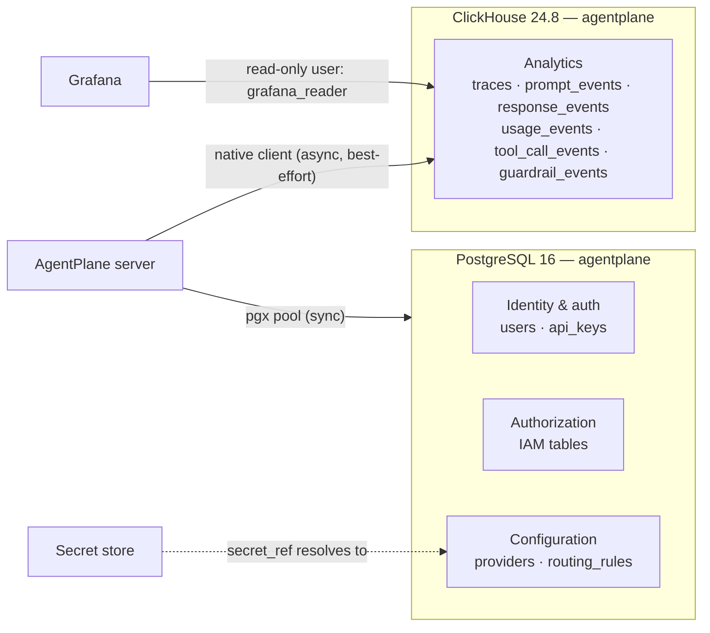
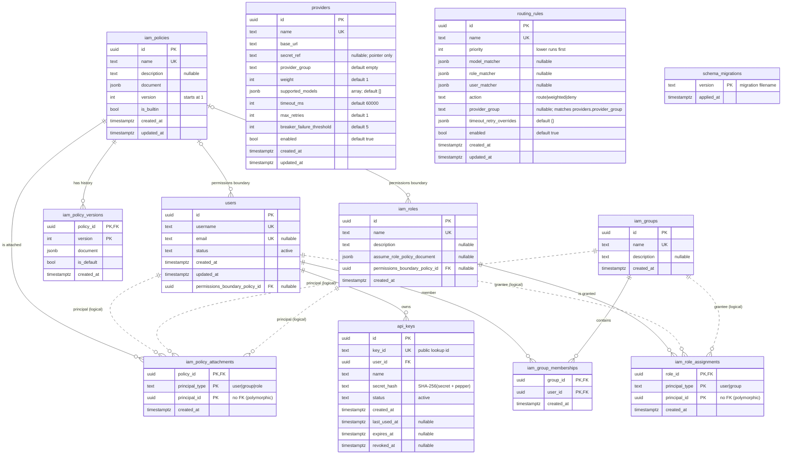
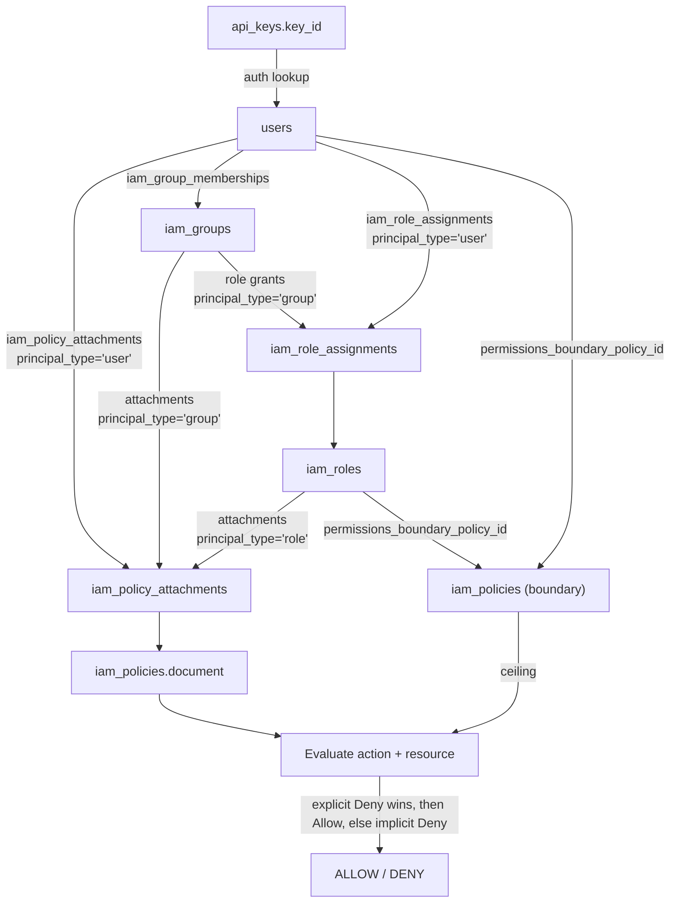
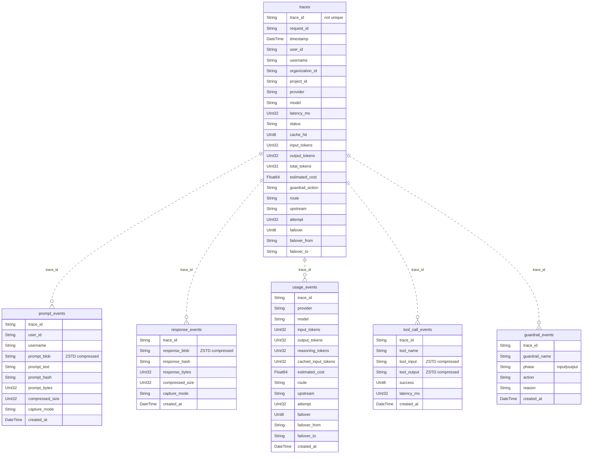

# Database Design

| | |
|---|---|
| **Status** | Current (V0.1) |
| **Sources of truth** | `migrations/*.up.sql` (PostgreSQL), `migrations/clickhouse/*.sql` (ClickHouse) |
| **Related** | [Architecture](architecture.md) · [IAM](iam.md) · [API Key Storage](api-key-storage-db-integration.md) · [Observability](../internal/observability/README.md) |

## 1. Overview

AgentPlane uses two stores with deliberately different jobs:

| Store | Version | Role | Written by | Read by |
|---|---|---|---|---|
| **PostgreSQL** | 16 | Operational source of truth: identity, credentials, authorization, provider/routing configuration | Gateway (synchronous) | Gateway, admin API, dashboard |
| **ClickHouse** | 24.8 | Append-only analytics: traces, prompt/response captures, usage, tool calls, guardrail outcomes | Gateway (best-effort, off the request's success path) | Analytics API, dashboard, Grafana |

Design principles:

1. **Postgres is authoritative.** Losing ClickHouse degrades analytics, never
   authentication or routing. Observability writes are best-effort and never
   fail a `/chat` request.
2. **No cross-store foreign keys.** `trace_id` is the only join key between the
   two stores; ClickHouse rows are denormalized so analytics queries need no
   joins.
3. **Secrets never live in the database.** `providers.secret_ref` is a pointer
   into the configured secret store (env, file, Vault, AWS, Azure); API keys are
   stored as `SHA-256(secret + pepper)` only.
4. **Deny by default.** A user with no policy attachment and no role grant has
   no permissions (`internal/iam`).
5. **Migrations are code.** Postgres migrations are embedded in the binary
   (`migrations/migrations.go`) and applied on startup under a Postgres advisory
   lock. ClickHouse DDL is idempotent bootstrap SQL.

## 2. Storage topology



Postgres schema is applied by `internal/db.Migrate`; ClickHouse schema by
`observability.Init()` reading `migrations/clickhouse/001_create_tables.sql`.

## 3. PostgreSQL ER diagram

Solid lines are real foreign keys. Dashed lines are **logical** relationships
through a polymorphic `(principal_type, principal_id)` pair, which Postgres
cannot express as an FK.



`providers` and `routing_rules` intentionally have **no** foreign key: a rule
selects a provider *group* by string, and membership in that group is
configuration on each provider row, not a relational link. This lets a rule
survive provider replacement and keeps weighted selection a runtime concern.

## 4. PostgreSQL table reference

### 4.1 `users`

| Column | Type | Constraints | Notes |
|---|---|---|---|
| `id` | `UUID` | PK, default `gen_random_uuid()` | Requires `pgcrypto` (created in `000001`) |
| `username` | `TEXT` | `NOT NULL`, `UNIQUE` | Login/display identity; uniqueness enforced by DB |
| `email` | `TEXT` | `UNIQUE`, nullable | Multiple `NULL`s allowed |
| `status` | `TEXT` | `NOT NULL` | Application constant `active`; no `CHECK` (see gaps) |
| `created_at` | `TIMESTAMPTZ` | `NOT NULL`, default `now()` | |
| `updated_at` | `TIMESTAMPTZ` | `NOT NULL`, default `now()` | Maintained by application writes |
| `permissions_boundary_policy_id` | `UUID` | FK → `iam_policies(id)` `ON DELETE SET NULL`, nullable | Per-user permission ceiling |

### 4.2 `api_keys`

| Column | Type | Constraints | Notes |
|---|---|---|---|
| `id` | `UUID` | PK, default `gen_random_uuid()` | Internal row id |
| `key_id` | `TEXT` | `NOT NULL`, `UNIQUE` | Public, non-secret lookup id sent as part of the key |
| `user_id` | `UUID` | `NOT NULL`, FK → `users(id)` | No DB cascade — see §6 |
| `name` | `TEXT` | `NOT NULL` | Human label (e.g. "CI pipeline") |
| `secret_hash` | `TEXT` | `NOT NULL` | Hex `SHA-256(secret + API_KEY_PEPPER)`; plaintext is never stored |
| `status` | `TEXT` | `NOT NULL` | `active` |
| `created_at` | `TIMESTAMPTZ` | `NOT NULL`, default `now()` | |
| `last_used_at` | `TIMESTAMPTZ` | nullable | Updated on successful authentication |
| `expires_at` | `TIMESTAMPTZ` | nullable | `NULL` = never expires; checked in Go |
| `revoked_at` | `TIMESTAMPTZ` | nullable | `NULL` = not revoked; revocation sets this only |

Authentication reads by `key_id`, then checks `status = 'active'`,
`revoked_at IS NULL`, and `expires_at` in `internal/auth`. Note that revocation
does **not** rewrite `status`; the timestamp is the authoritative revocation
marker.

### 4.3 `iam_policies`

| Column | Type | Constraints | Notes |
|---|---|---|---|
| `id` | `UUID` | PK, default `gen_random_uuid()` | |
| `name` | `TEXT` | `NOT NULL`, `UNIQUE` | Referenced by admin API paths |
| `description` | `TEXT` | nullable | |
| `document` | `JSONB` | `NOT NULL` | Validated in Go before storage (`internal/iam/validate.go`) |
| `version` | `INTEGER` | `NOT NULL`, default `1` | Current (latest) version number |
| `is_builtin` | `BOOLEAN` | `NOT NULL`, default `FALSE` | Seeded policies (`APAdmin`, `APMember`, …) |
| `created_at` | `TIMESTAMPTZ` | `NOT NULL`, default `now()` | |
| `updated_at` | `TIMESTAMPTZ` | `NOT NULL`, default `now()` | |

Policy document shape (v1):

```json
{
  "Version": "2026-01-01",
  "Statement": [
    {
      "Sid": "AllowInvoke",
      "Effect": "Allow",
      "Action": ["ap:InvokeChat", "ap:InvokeModel"],
      "Resource": ["arn:ap:*"]
    }
  ]
}
```

`Condition` is modelled but rejected at write time in v1, so an unevaluatable
`Deny` can never be stored and silently ignored.

### 4.4 `iam_policy_versions`

Immutable document history for rollback/least-privilege tightening.

| Column | Type | Constraints | Notes |
|---|---|---|---|
| `policy_id` | `UUID` | PK, FK → `iam_policies(id)` `ON DELETE CASCADE` | |
| `version` | `INTEGER` | PK | Composite PK `(policy_id, version)` |
| `document` | `JSONB` | `NOT NULL` | Snapshot of the document at that version |
| `is_default` | `BOOLEAN` | `NOT NULL`, default `TRUE` | One default at a time (maintained in app) |
| `created_at` | `TIMESTAMPTZ` | `NOT NULL`, default `now()` | |

The five-version cap is enforced in `internal/iam/store.go`, not by a
constraint.

### 4.5 `iam_groups`

| Column | Type | Constraints |
|---|---|---|
| `id` | `UUID` | PK, default `gen_random_uuid()` |
| `name` | `TEXT` | `NOT NULL`, `UNIQUE` |
| `description` | `TEXT` | nullable |
| `created_at` | `TIMESTAMPTZ` | `NOT NULL`, default `now()` |

### 4.6 `iam_roles`

| Column | Type | Constraints | Notes |
|---|---|---|---|
| `id` | `UUID` | PK, default `gen_random_uuid()` | |
| `name` | `TEXT` | `NOT NULL`, `UNIQUE` | Also used by `routing_rules.role_matcher` |
| `description` | `TEXT` | nullable | |
| `assume_role_policy_document` | `JSONB` | nullable | Validated; session issuance is v2 |
| `permissions_boundary_policy_id` | `UUID` | FK → `iam_policies(id)` `ON DELETE SET NULL`, nullable | Ceiling for the role |
| `created_at` | `TIMESTAMPTZ` | `NOT NULL`, default `now()` | |

### 4.7 `iam_policy_attachments`

One row per policy attached to a user, group, or role.

| Column | Type | Constraints | Notes |
|---|---|---|---|
| `policy_id` | `UUID` | PK, FK → `iam_policies(id)` `ON DELETE CASCADE` | |
| `principal_type` | `TEXT` | PK, `CHECK IN ('user','group','role')` | |
| `principal_id` | `UUID` | PK | Deliberately no FK — target table depends on `principal_type` |
| `created_at` | `TIMESTAMPTZ` | `NOT NULL`, default `now()` | |

### 4.8 `iam_group_memberships`

| Column | Type | Constraints | Notes |
|---|---|---|---|
| `group_id` | `UUID` | PK, FK → `iam_groups(id)` `ON DELETE CASCADE` | |
| `user_id` | `UUID` | PK, FK → `users(id)` `ON DELETE CASCADE` | |
| `created_at` | `TIMESTAMPTZ` | `NOT NULL`, default `now()` | |

### 4.9 `iam_role_assignments`

| Column | Type | Constraints | Notes |
|---|---|---|---|
| `role_id` | `UUID` | PK, FK → `iam_roles(id)` `ON DELETE CASCADE` | |
| `principal_type` | `TEXT` | PK, `CHECK IN ('user','group')` | Roles cannot be granted to roles |
| `principal_id` | `UUID` | PK | No FK (polymorphic), like attachments |
| `created_at` | `TIMESTAMPTZ` | `NOT NULL`, default `now()` | |

### 4.10 `providers`

| Column | Type | Constraints / default | Notes |
|---|---|---|---|
| `id` | `UUID` | PK, default `gen_random_uuid()` | |
| `name` | `TEXT` | `NOT NULL`, `UNIQUE`, non-blank `CHECK` | Upstream identifier |
| `base_url` | `TEXT` | `NOT NULL`, non-blank `CHECK` | OpenAI-compatible base URL |
| `secret_ref` | `TEXT` | nullable | Name of a secret-store entry, never the credential |
| `provider_group` | `TEXT` | `NOT NULL`, default `''` | Added in `000007`; matched by routing rules |
| `weight` | `INTEGER` | `NOT NULL`, default `1`, `CHECK >= 0` | Weighted primary selection; `0` means ineligible |
| `supported_models` | `JSONB` | `NOT NULL`, default `'[]'`, `CHECK` is array | e.g. `["gpt-4o","gpt-4o-mini"]`; empty = any |
| `timeout_ms` | `INTEGER` | `NOT NULL`, default `60000`, `CHECK > 0` | Per-request timeout |
| `max_retries` | `INTEGER` | `NOT NULL`, default `1`, `CHECK >= 0` | In-place retries before failover |
| `breaker_failure_threshold` | `INTEGER` | `NOT NULL`, default `5`, `CHECK >= 1` | Added in `000008` |
| `enabled` | `BOOLEAN` | `NOT NULL`, default `TRUE` | Operator on/off switch |
| `created_at` | `TIMESTAMPTZ` | `NOT NULL`, default `now()` | |
| `updated_at` | `TIMESTAMPTZ` | `NOT NULL`, default `now()` | |

### 4.11 `routing_rules`

| Column | Type | Constraints / default | Notes |
|---|---|---|---|
| `id` | `UUID` | PK, default `gen_random_uuid()` | |
| `name` | `TEXT` | `NOT NULL`, `UNIQUE`, non-blank `CHECK` | |
| `priority` | `INTEGER` | `NOT NULL`, default `0` | Lower evaluates first; first match wins |
| `model_matcher` | `JSONB` | nullable, `CHECK` is object | `{equals}` / `{in:[...]}` / `{prefix}` |
| `role_matcher` | `JSONB` | nullable, `CHECK` is object | Matches effective IAM role names |
| `user_matcher` | `JSONB` | nullable, `CHECK` is object | Matches user attributes |
| `action` | `TEXT` | `NOT NULL`, non-blank `CHECK` | Application values: `route`, `weighted`, `deny` (no enum in DB) |
| `provider_group` | `TEXT` | nullable | Selects `providers` with the same group |
| `timeout_retry_overrides` | `JSONB` | `NOT NULL`, default `'{}'`, `CHECK` is object | `timeout_ms`, `max_retries`, `backoff_*`, `jitter_percent` |
| `enabled` | `BOOLEAN` | `NOT NULL`, default `TRUE` | |
| `created_at` | `TIMESTAMPTZ` | `NOT NULL`, default `now()` | |
| `updated_at` | `TIMESTAMPTZ` | `NOT NULL`, default `now()` | |

A rule with no matchers is a catch-all. `provider_group` is a **plain string**,
not a JSON list; weights live on `providers.weight`. (`docs/routing-admin.md`
still describes an older JSON-array shape — the schema is authoritative.)

### 4.12 `schema_migrations`

| Column | Type | Constraints | Notes |
|---|---|---|---|
| `version` | `TEXT` | PK | Full migration filename, e.g. `000009_create_iam_tables.up.sql` |
| `applied_at` | `TIMESTAMPTZ` | `NOT NULL`, default `now()` | |

Created lazily by `internal/db.Migrate`, outside the numbered sequence.

### 4.13 Code ownership map

| Table(s) | Owner package | Notes |
|---|---|---|
| `users` | `internal/users` | Also orchestrates cross-table user deletion |
| `api_keys` | `internal/api` (write), `internal/auth` (read) | Split keeps hashing/lifecycle apart from verification |
| `iam_*` | `internal/iam` | `internal/policy` is the generic enforcement spine, not a table owner |
| `providers` | `internal/proxy` (`ProviderStore`) | Loaded into the runtime registry |
| `routing_rules` | `internal/proxy` (`RoutingRuleStore`) | Compiled into the in-memory rule set |
| `schema_migrations` | `internal/db` | Migration runner only |
| ClickHouse `agentplane.*` | `internal/observability` + `internal/clickhouse` | Adapter interface keeps the gateway vendor-neutral |

## 5. Index catalog

All indexes below are created by the migrations; no separate index exists on
`api_keys.key_id` or on the unique `name` columns because the `UNIQUE`
constraint already supplies one.

| Table | Index | Definition / purpose |
|---|---|---|
| `api_keys` | `idx_api_keys_user_id` | `(user_id)` — list a user's keys |
| `iam_policy_attachments` | `idx_iam_attachments_principal` | `(principal_type, principal_id)` — "what is attached to this principal" |
| `iam_group_memberships` | `idx_iam_group_memberships_user` | `(user_id)` — "which groups is this user in" |
| `iam_role_assignments` | `idx_iam_role_assignments_principal` | `(principal_type, principal_id)` — "which roles does this principal hold" |
| `providers` | `idx_providers_enabled` | `(enabled)` |
| `providers` | `idx_providers_enabled_weight` | `(enabled, weight)` |
| `providers` | `idx_providers_enabled_group_weight` | `(provider_group, enabled, weight)` — group candidate scan |
| `providers` | `idx_providers_supported_models` | GIN on `supported_models` |
| `routing_rules` | `idx_routing_rules_priority` | `(priority, id) WHERE enabled` — evaluation order |
| `routing_rules` | `idx_routing_rules_provider_group` | `(provider_group) WHERE enabled` |
| `routing_rules` | `idx_routing_rules_model_matcher` | GIN on `model_matcher` |
| `routing_rules` | `idx_routing_rules_role_matcher` | GIN on `role_matcher` |
| `routing_rules` | `idx_routing_rules_user_matcher` | GIN on `user_matcher` |

## 6. Referential actions and row lifecycle

| Parent action | Child rows | Mechanism |
|---|---|---|
| Delete policy | `iam_policy_versions`, `iam_policy_attachments` | `ON DELETE CASCADE` |
| Delete group | `iam_group_memberships` (DB cascade); group's policy attachments and role grants | Memberships cascade; **polymorphic rows are not cleaned up** — `DeleteGroup` only deletes the group row (see gaps) |
| Delete role | Role's own grants (`role_id` cascade); policy attachments to the role | `iam_role_assignments.role_id` cascades; **`iam_policy_attachments` rows with `principal_type='role'` are left behind** |
| Delete user | `api_keys`, memberships, policy attachments, role assignments | **Application transaction** in `users.Store.DeleteUser` (no cascade on `api_keys`) |
| Delete policy used as a boundary | `users.permissions_boundary_policy_id`, `iam_roles.permissions_boundary_policy_id` | `ON DELETE SET NULL` (identity loses its ceiling but keeps other policies) |
| Revoke API key | none | `UPDATE api_keys SET revoked_at = now()` |
| Deactivate API key | none | Set `status` (authentication requires `active`) |

Deleting a user is intentionally the one multi-table write in `internal/users`:
it removes API keys, principal attachments, role assignments, and group
memberships in a single transaction so no dangling credential or grant remains.

## 7. How authorization resolves across tables



`Store.LoadPrincipalPolicies` resolves the union in one query:

```sql
WITH user_groups AS (
    SELECT group_id FROM iam_group_memberships WHERE user_id = $1
), user_roles AS (
    SELECT role_id FROM iam_role_assignments
    WHERE (principal_type = 'user'  AND principal_id = $1)
       OR (principal_type = 'group' AND principal_id IN (SELECT group_id FROM user_groups))
)
SELECT DISTINCT p.document
FROM iam_policies p
JOIN iam_policy_attachments a ON a.policy_id = p.id
WHERE (a.principal_type = 'user'  AND a.principal_id = $1)
   OR (a.principal_type = 'group' AND a.principal_id IN (SELECT group_id FROM user_groups))
   OR (a.principal_type = 'role'  AND a.principal_id IN (SELECT role_id FROM user_roles));
```

The boundary is loaded separately (`LoadPermissionsBoundary`) and applied as a
ceiling after the union, so a boundary can only subtract permissions.

## 8. Migration history

| Migration | Creates / changes | Notes |
|---|---|---|
| `000001_create_users_table` | `users`, `pgcrypto` | |
| `000002_create_api_keys_table` | `api_keys`, `idx_api_keys_user_id` | `key_id` unique index doubles as lookup |
| `000003_create_rbac_tables` | `roles`, `role_permissions`, `user_roles` + built-in roles | **Superseded**; dropped by `000010` |
| `000006_create_routing_tables` | `providers`, `routing_rules` + indexes | |
| `000007_add_provider_group` | `providers.provider_group`, group index | |
| `000008_add_breaker_failure_threshold` | `providers.breaker_failure_threshold` | |
| `000009_create_iam_tables` | All `iam_*` tables, `users.permissions_boundary_policy_id` | Introduces deny-wins model |
| `000010_migrate_rbac_to_iam` | Data migration RBAC → IAM, drops legacy RBAC tables | Idempotent, tolerant of custom permissions |

Operational properties:

- Filename order is lexicographic; numbering gaps (no `000004`/`000005` in the
  repository) are harmless.
- `000010` is a `DO $$ … $$` block: it returns early if the legacy RBAC schema
  is absent, so fresh databases and upgraded databases converge.
- Each migration and its `schema_migrations` insert run in **one transaction**.
- Concurrent server startups serialize on `pg_advisory_lock(8152019)`.
- `*.down.sql` files exist for manual rollback but the server never runs them.

## 9. ClickHouse schema

ClickHouse is used append-only. There are no foreign keys and no unique
constraints, and rows are never updated in place — duplicate `trace_id` rows are
possible if a write is retried. Relationships below are logical, joined on
`trace_id`.



| Table | Engine / order | TTL | Purpose |
|---|---|---|---|
| `traces` | `MergeTree ORDER BY (timestamp, organization_id, user_id)` | 365 days | One row per request: latency, status, tokens, cost, route/failover metadata |
| `usage_events` | `MergeTree ORDER BY (created_at, provider, model)` | 365 days | Normalized usage incl. reasoning/cached tokens, provider/model |
| `prompt_events` | `MergeTree ORDER BY (created_at, trace_id)` | 30 days | Prompt capture: compressed blob + hash + size + capture mode |
| `response_events` | `MergeTree ORDER BY (created_at, trace_id)` | 30 days | Response capture: same shape as prompts |
| `tool_call_events` | `MergeTree ORDER BY (created_at, trace_id)` | 30 days | Tool invocation input/output; **not currently instrumented** |
| `guardrail_events` | `MergeTree ORDER BY (created_at, trace_id)` | 60 days | Per-rule guardrail outcome; `reason` intentionally empty |

Bloom-filter skip indexes: `traces` on `organization_id`, `user_id`, `model`;
`trace_id` on prompts, responses, tool calls, and guardrail events.

Storage notes:

- `trace_id` is the correlation key across all six tables; `request_id` is an
  alternate request identifier on `traces` only.
- `organization_id` / `project_id` are **string dimensions only**. There are no
  `organizations` or `projects` tables in Postgres; values come from the caller
  context (or the demo seed). Normalizing them requires a future schema change.
- Capture modes (`disabled`, `full`, `sampled`, `hash_only`) are recorded per
  row, so retention and sampling are auditable.
- Cost is an estimate for analytics, not billing.

### 9.1 Read-only Grafana access

`migrations/clickhouse/002_grafana_reader.sql` creates
`grafana_reader` (`SELECT` on `agentplane.*` only) so the datasource cannot
write or alter data. The development password is `agentplane`; deployment
manifests must override it and keep `CLICKHOUSE_GRAFANA_PASSWORD` in sync.

## 10. Design decisions and trade-offs

| Decision | Rationale | Cost |
|---|---|---|
| **Two stores, split by workload** | Analytics volume and retention differ by orders of magnitude from operational data; an analytics outage must not stop chat | Two schemas, two clients, eventual consistency of analytics |
| **One polymorphic attachment table** | A policy can attach to user/group/role without three near-identical tables | Cannot enforce `principal_id` with an FK; application must clean orphans |
| **JSONB policy documents** | AWS-style `Allow`/`Deny`/`NotAction`/`NotResource` with wildcards; validated in Go | DB cannot constrain document semantics |
| **Immutable policy versions** | Audit trail and rollback; five-version cap mirrors AWS | Extra rows and application-managed "default" flag |
| **`provider_group` as a string** | Rules survive provider replacement; weighted membership stays a provider property | No referential integrity; typos silently select nobody |
| **`supported_models` as JSONB array** | Flexible per-provider model lists with GIN index | Filtering still happens in Go during selection |
| **`secret_ref`, not secrets** | Keeps credentials in Vault/KMS/env; DB compromise does not leak upstream keys | Secret-store availability is on the request path |
| **SHA-256 + pepper for API keys** | Keys are high-entropy random values, so a fast hash is appropriate; plaintext is shown once | Pepper rotation requires a re-key strategy |
| **Denormalized trace dimensions** | ClickHouse queries stay single-table and fast | Renames (user/org) do not propagate to history |
| **Timestamp-based revocation** | Revocation is auditable and idempotent | `status` and `revoked_at` can disagree if written incorrectly |
| **`updated_at` maintained by app** | No trigger logic to hide | Direct SQL updates must set it manually |

## 11. Known gaps and follow-ups

| Priority | Gap | Recommendation |
|---|---|---|
| High | Polymorphic `principal_id` has no FK. `DeleteGroup` and `DeleteRole` leave orphaned `iam_policy_attachments` / `iam_role_assignments` rows, and `DeleteUser` relies on application cleanup | Clean up polymorphic rows in the same transaction as group/role deletion; add an integrity check, or split into per-type junction tables |
| Medium | `users.status` and `api_keys.status` are free-text | Add `CHECK` constraints (`active`, `disabled`) and document that API-key revocation is represented by `revoked_at`, not `status` |
| Medium | No `CHECK` on `routing_rules.action` | Constrain to `route`, `weighted`, or `deny` |
| Medium | No organization/project tables despite telemetry dimensions | Introduce `organizations`/`projects` + IDs in `users` when multi-tenancy lands |
| Medium | `docs/routing-admin.md` describes `provider_group` as JSONB | Align doc with `TEXT` schema |
| Low | Policy version cap and `is_default` uniqueness enforced in app | Add a partial unique index on `(policy_id) WHERE is_default` |
| Low | No index for active/expiring keys | Add `(status, expires_at) WHERE revoked_at IS NULL` if key counts grow |
| Low | ClickHouse schema bootstrap needs a relative `migrations/` path at runtime | Embed the SQL like Postgres migrations |
| Low | No deduplication on ClickHouse `trace_id` | Query with `argMax`/`LIMIT 1 BY trace_id`, or add a deduplicating layer keyed on `trace_id`; accept at-least-once writes meanwhile |

## 12. Common access patterns

**Authenticate an API key**

```sql
SELECT key_id, user_id, secret_hash, status, expires_at, revoked_at
FROM api_keys
WHERE key_id = $1;
```

Covered by the unique `key_id` index; the hash comparison happens in Go with a
constant-time compare.

**Load enabled routing rules in evaluation order**

```sql
SELECT id, name, priority, model_matcher, role_matcher, user_matcher,
       action, COALESCE(provider_group, ''), timeout_retry_overrides, enabled
FROM routing_rules
WHERE enabled
ORDER BY priority ASC, id ASC;
```

**Load candidate providers for a group**

```sql
SELECT id, name, base_url, secret_ref, provider_group, weight,
       supported_models, timeout_ms, max_retries, breaker_failure_threshold
FROM providers
WHERE enabled
ORDER BY name;
```

Group and model filtering then happens in `registry.Candidates`, which keeps
the failover/breaker logic in one place.

**Recent traces for one user**

```sql
SELECT timestamp, trace_id, request_id, provider, model, status,
       latency_ms, total_tokens, estimated_cost
FROM agentplane.traces
WHERE user_id = {user_id:String}
  AND timestamp >= now() - INTERVAL 24 HOUR
ORDER BY timestamp DESC
LIMIT 100;
```

## 13. Verifying the schema

```bash
# Apply Postgres migrations (also happens on server startup)
go run ./cmd/server

# Inspect tables and constraints
psql "$DATABASE_URL" -c '\dt'
psql "$DATABASE_URL" -c '\d+ api_keys'
psql "$DATABASE_URL" -c 'SELECT version, applied_at FROM schema_migrations ORDER BY version'

# Confirm the IAM union query
psql "$DATABASE_URL" -c "SELECT name, version, is_builtin FROM iam_policies ORDER BY name"

# ClickHouse
clickhouse-client --query 'SHOW TABLES FROM agentplane'
clickhouse-client --query 'SHOW CREATE TABLE agentplane.traces'
```

Schema changes must be added as a new numbered `*.up.sql` (and matching
`*.down.sql`) pair; never edit an applied migration, because
`schema_migrations` records it as done.
